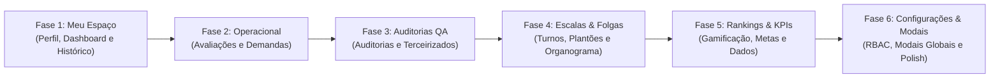

# 🗺️ Roadmap HubDesk v4.0.0 — O Grande Salto Visual & Operacional

> **Objetivo:** Repaginar 100% das telas, modais e componentes do Hubdesk para transformar o sistema em um produto SaaS executivo de classe mundial (padrão **Behance / Linear / Vercel / Magic UI**), com consistência rigorosa às regras de design registradas no [`preferencias.md`](preferencias.md).

---

## 🏆 Status Atual do Projeto (Concluído)

| Componente / Tela | Descrição da Refatoração | Status |
|---|---|:---:|
| **Design System & Tokens** | Tokens semânticos nos 3 temas (Claro, Morno, Escuro), utilitários semânticos no `index.css` e `cn.js`. | ✅ Concluído |
| **Kit UI Atômico** | `Button`, `Badge`, `Card`, `StatCard`, `Input`, `Modal`, `Tabs`, `EmptyState`, `CommandPalette`. | ✅ Concluído |
| **Componentes Magic UI** | `MagicCard` (spotlight), `BorderBeam` (feixe perimetral), `ShineBorder`, `AnimatedShinyText`. | ✅ Concluído |
| **Shell & Layout Principal** | `AdminDashboard.jsx`: sidebar em dark glassmorphism, luz volumétrica, pílula deslizante Framer Motion, launcher `Ctrl+K`. | ✅ Concluído |
| **Tela de Login** | `Login.jsx`: painel cinematográfico duplo, vitrine executiva com Bento de 3 pilares e `BorderBeam`. | ✅ Concluído |
| **Modal de Atualizações** | `VersionChangelogModal.jsx`: dark glassmorphism, timeline vertical conectada, filtro por versão e zero indicadores falsos de online. | ✅ Concluído |
| **Hub da Equipe** | `CollaboratorsHub.jsx`: Bento Grid com MVP e BorderBeam, Radar de 4 turnos interativo, Crachás digitais com MagicCard, padrão somente ativos e zero bordas pretas duras. | ✅ Concluído |
| **Cockpit KPIs (Visão Geral)** | `DashboardOverview.jsx`: repaginado v4.0 com título no fundo da página, barra de filtros interativos em tempo real (Turnos e Períodos), abas de Cockpit, Analytics, Semáforo de Metas e Squads, Recharts dinâmico com tooltip dark e BorderBeam. | ✅ Concluído |
| **Documento de Preferências** | `preferencias.md`: regras consolidadas do que o usuário gosta e não gosta. | ✅ Concluído |

---

## 🧭 Cronograma de Repaginação da v4.0.0

A repaginação dos elementos restantes está estruturada em **6 Fases Temáticas**:

---

### 👤 FASE 1: Espaço Individual do Colaborador (Meu Espaço) — [100% CONCLUÍDO ✅]
*Foco: Elevar a experiência do colaborador individual com cockpit pessoal, histórico de avaliações e perfil gamificado.*

- [x] **1.1. `MyDashboard.jsx` (Meu Desempenho)** ✅
  - Cockpit individual com métricas da semana atual (finalizados, voz, chat, pontuação).
  - Indicador de metas pessoais com barra de progresso visual.
  - Micro-gráfico de evolução comparativa com semanas anteriores.
- [x] **1.2. `MyProfile.jsx` (Meu Perfil)** ✅
  - Crachá digital pessoal em tamanho expandido com acabamento executivo e personalização de capa (8 presets + HTTPS).
  - Vitrine de badges e conquistas gamificadas com detalhes de desbloqueio automatizados em tempo real.
  - Calculador visual de nível (Nível 1 a 6 com barra de XP/emblemas).
  - Modal de contato obrigatório (`MandatoryContactModal.jsx`) com `BorderBeam` e tokens semânticos.
- [x] **1.3. `MyHistory.jsx` (Meu Histórico)** ✅
  - Central unificada com timeline de feedbacks 1:1, avaliações semanais e auditorias.
  - Repaginar subcomponentes de visualização:
    - [x] `MarkdownFeedbackView.jsx` (Leitor moderno de feedback 1:1 com ciência).
    - [x] `LegacyFeedbackView.jsx` (Visualizador dos 4 pilares com banner de arquivo).
    - [x] `FeedbackDetailModal.jsx` (Modal de detalhamento com `BorderBeam`).
    - [x] `MonthlyEvaluationDetailModal.jsx` (Modal mensal com `BorderBeam` e print).
    - [x] `WeeklyMetricDetailModal.jsx` (Extrato de cálculo com `BorderBeam`).
    - [x] `AuditDetailModal.jsx` (Checklist interativo passo a passo com `BorderBeam`).

---

### ⚡ FASE 2: Lançamentos & Gestão Operacional — [100% CONCLUÍDO ✅]
*Foco: Agilidade e clareza executiva no acompanhamento de chamados e preenchimento de avaliações.*

- [x] **2.1. `WeeklyMetrics.jsx` (Avaliações Semanais)** ✅
  - Tabela enterprise de preenchimento ágil de notas com cálculo de pontuação instantâneo.
  - Filtros avançados por turno oficial (Manhã I, II, Tarde, Noturno).
  - Destaque automático para notas em destaque ou quedas acentuadas, import/export CSV e Bento KPIs.
- [x] **2.2. `MonthlyEvaluations.jsx` (Análise Mensal 1:1)** ✅
  - Editor split-screen com Markdown em tempo real para planos de desenvolvimento individual (PDI).
  - Indicador de status de ciência do colaborador com carimbo temporal auditado.
  - Painel de pendências de leitura para o gestor com BorderBeam e design tokens.
- [x] **2.3. `DailyDemandLaunch.jsx` (Demanda Diária)** ✅
  - Painel de acompanhamento de filas e volumetria diária de chamados.
  - Gráficos de dispersão e pico por hora e turno, tabela enterprise sem bordas pretas e BorderBeam.
- [x] **2.4. `Reports.jsx` (Tarefas & Relatórios)** ✅
  - Cabeçalho limpo no fundo da tela (regra Hub da Equipe) com botões e seletores no topo.
  - Ribbon de 6 cartões de status/quantidade com novo status **Suspenso** (Total, Pendentes, Em Andamento, Suspensos, Resolvidos, Afeta Cliente).
  - Quadro Kanban com 5 colunas fluidas e suporte a Suspenso.
  - Repaginação de gavetas e modais:
    - [x] `TicketDrawer.jsx` (Gaveta lateral ultra-moderna de detalhes do ticket com status Suspenso e botão de ação rápida).
    - [x] `TaskFormModal.jsx` / `NewRequestModal.jsx` (Modal de Novo Chamado/O.S. repaginado v4.0 com seletor de categorias em cards interativos com SLA, bento grid de metadados, presets de prazo rápidos, seletor de prioridade em pills, impacto no cliente expansivo, editor Markdown rico em abas e BorderBeam perimetral).
    - [x] `ReportDetailModal.jsx` (Modal de Visualização Expandido de Detalhes v4.0 com stepper de status dinâmico incluindo Suspenso, bento grid de metadados operacionais, SLA em tempo real, painel de despacho de liderança com parecer técnico, thread de comentários com respostas rápidas, cópia de resumo formatado e BorderBeam perimetral).
    - [x] `MassiveOutageBanner.jsx` (Banner de instabilidade em massa com alerta pulsante).
    - [x] `SafeMarkdown.jsx` (Renderizador seguro anti-XSS com GFM).

---

### 🛡️ FASE 3: Auditorias de Qualidade (QA)
*Foco: Painéis de conformidade, relatórios analíticos de falhas e auditoria de parceiros.*

- [ ] **3.1. `Audits.jsx` (Auditorias Internas QA)**
  - Painel com média geral de conformidade QA, taxa de assertividade e falhas críticas.
  - Repaginação completa dos subcomponentes de auditoria:
    - [ ] `AuditTable.jsx` (Tabela de auditorias com status, notas e filtros).
    - [ ] `AuditMetrics.jsx` (Métricas de itens mais reprovados e evolução da equipe).
    - [ ] `AuditRanking.jsx` (Classificação dos analistas mais auditados).
    - [ ] `AuditFilters.jsx` (Barra de pesquisa e filtros por data/supervisor).
    - [ ] `AuditFormModal.jsx` (Formulário dinâmico de preenchimento de checklist).
    - [ ] `AuditDetailsModal.jsx` (Ficha de auditoria detalhada com justificativas).
- [ ] **3.2. `ThirdPartyAudits.jsx` (Auditorias Terceirizadas)**
  - Cockpit de acompanhamento de atendimento externo/terceirizado com comparativo de notas.

---

### 📅 FASE 4: Escalas, Plantões & Organograma
*Foco: Visualização cristalina de horários, turnos, folgas e estrutura hierárquica.*

- [ ] **4.1. `OperationalSchedules.jsx` (Escalas Operacionais)**
  - Unificação moderna das abas Diária (`DailySchedule.jsx`) e Plantão de Domingo (`SundaySchedule.jsx`).
  - Tabela com cores oficiais de cada turno e detecção de sobreposição de horários.
- [ ] **4.2. `DayOffSchedule.jsx` (Escala de Folgas)**
  - Calendário interativo estilo cockpit mensal com visualização clara de folgas programadas.
  - Indicador de cobertura mínima de equipe por turno para evitar furos operacionais.
- [ ] **4.3. `OrgChart.jsx` (Organograma Operacional)**
  - Árvore hierárquica fluida com cards de gestor, supervisores, apoios e analistas.
  - Controles de zoom, busca rápida de colaboradores na árvore e exportação limpa.

---

### 🏆 FASE 5: Rankings, KPIs do Setor & Gestão de Dados — [100% CONCLUÍDO ✅]
*Foco: Celebração de resultados, métricas macro corporativas e ferramentas de dados.*

- [x] **5.1. `Rankings.jsx` (Pódio & Gamificação da Equipe)** ✅
  - Cabeçalho limpo no fundo da página padrão Hub da Equipe.
  - Pódio executivo para o 1º, 2º e 3º colocados com acabamento metálico e badges de conquistas.
  - Tabela geral de posições com indicadores de evolução e exportação CSV.
- [x] **5.2. `SectorKPIs.jsx` (KPIs Macro do Setor)** ✅
  - Cabeçalho solto no fundo da página, sem containers pesados.
  - Painel executivo de alto nível com TMA, TMR, FCR, metas globais e SLAs consolidados.
- [x] **5.3. `DataManager.jsx` (Gestor de Dados & Auditoria)** ✅
  - Novo padrão de cabeçalho no fundo da tela (estilo Hub da Equipe) com botões principais no topo.
  - Revisão substancial e despoluição radical da coluna "Resumo do Dado" (tags compactas, dot sutil, fim do empilhamento excessivo).
  - Correção total de cores em botões e seletores (zero botões brancos no modo claro ou pretos no modo escuro).
  - Dropdown e modal de exportação rápida (.csv e .md para IA) com alto contraste.

---

### ⚙️ FASE 6: Configurações, Segurança & Modais Globais — [100% CONCLUÍDO ✅]
*Foco: Fechamento da v4.0.0 com segurança RBAC, modais corporativos e polimento geral.*

- [x] **6.1. `Settings.jsx` (Configurações Gerais)** ✅
  - Hero Header Bento executivo e design tokens semânticos.
  - Gestão de parâmetros operacionais (tolerâncias de TMA/TME, regras de pontuação).
  - Prazos de SLA configuráveis por categoria ISP com opção de restaurar padrões.
  - Expedientes e turnos oficiais e operação terceirizada noturna.
  - Notificações Web Push com testes em tempo real e alerta sonoro suave.
  - Gestão de permissões RBAC (`RbacSettingsTab.jsx`) sem bordas pretas.
  - Tags de feedback e categorias (`FeedbackTagsTab.jsx`).
  - Configuração de processos de QA (`QaProcessesTab.jsx`, `QaProcessModal.jsx`, `QaProcessPreviewModal.jsx`).
- [x] **6.2. `DataManager.jsx` (Central de Dados & Auditoria)** ✅
  - Hero Header executivo e abas com design tokens.
  - Menu de exportação rápida para Excel (.csv) e Markdown (.md) para IA.
  - Tabela enterprise com paginação e sem divisórias pretas.
  - Modais de detalhes, edição e exclusão com `BorderBeam`.
- [x] **6.3. Modais & Componentes Globais** ✅
  - `VersionChangelogModal.jsx` (Modal com `BorderBeam` e lançamento oficial da v4.0.0).
  - Atualização do `package.json` para v4.0.0.
  - Conformidade total com [`preferencias.md`](preferencias.md).

---

## 📌 Checklist de Conformidade com [`preferencias.md`](preferencias.md)
Para **cada tela** refatorada ao longo das fases, verificar obrigatoriamente:

1. [ ] **Tipografia Fixo & Nítida:** Zero textos com animação contínua correndo de um lado para o outro (*shimmer marquee*).
2. [ ] **Bordas Sutis:** Zero linhas pretas pesadas (`currentColor` ou `border-black`). Utilizar sempre `border-subtle` (`#e2e8f0` no light).
3. [ ] **Presença Real:** Zero falsos indicadores de "online" pulsantes (sem tracking de presença real no sistema).
4. [ ] **Padrão Somente Ativos:** Onde houver listagens de pessoas, o filtro inicial deve ser sempre de colaboradores ativos.
5. [ ] **Identidade Carmesim:** Acentos em Rose/Carmesim (`#e11d48`, `#f43f5e`) preservados nos 3 temas (Claro, Morno e Escuro).
6. [ ] **Testes & Build:** 100% dos testes unitários passando (`npm test`) e `npm run build` com 0 erros.

---

*Fases 1 (Meu Espaço), 2 (Lançamentos Operacionais), 5 (Rankings, KPIs & Gestão de Dados) e 6 (Configurações 100% Width & RBAC & Modais Globais) 100% concluídas com sucesso. Restam as Fases 3 (Auditorias QA) e 4 (Escalas & Folgas).*
